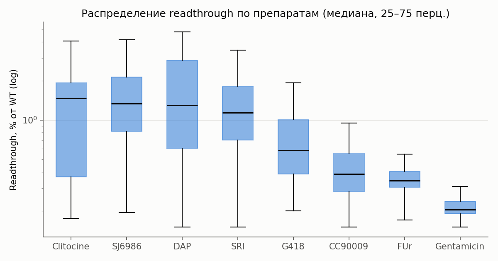
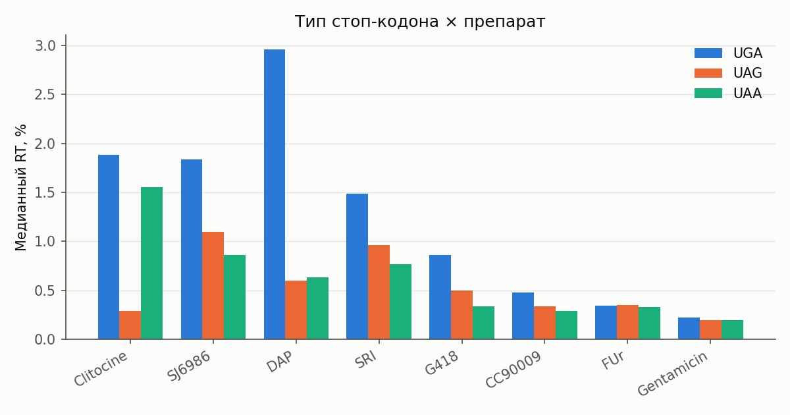
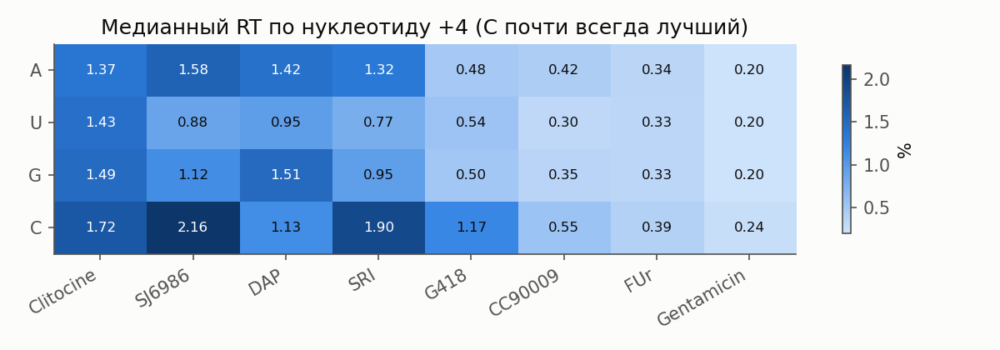
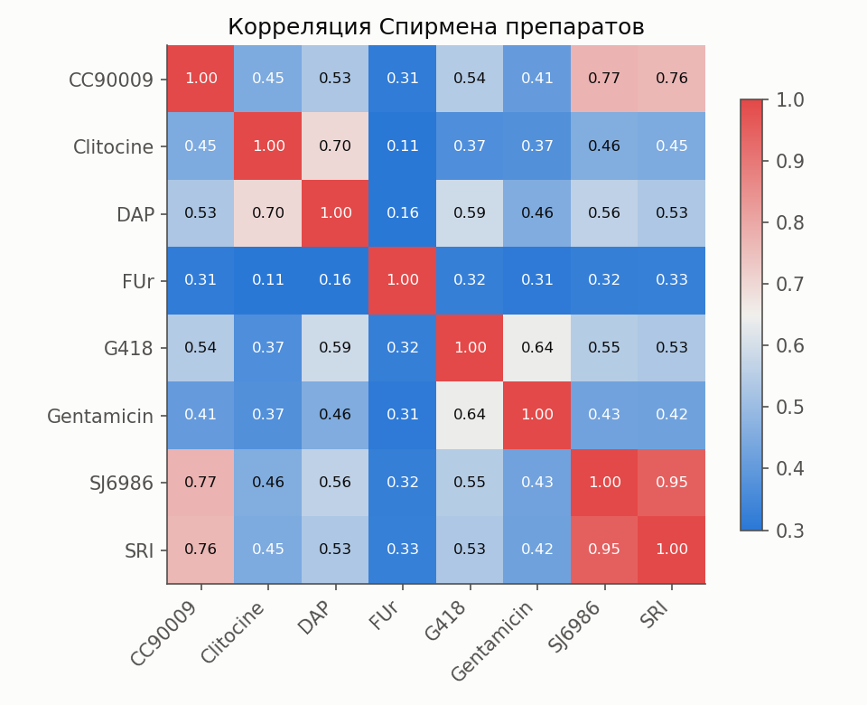
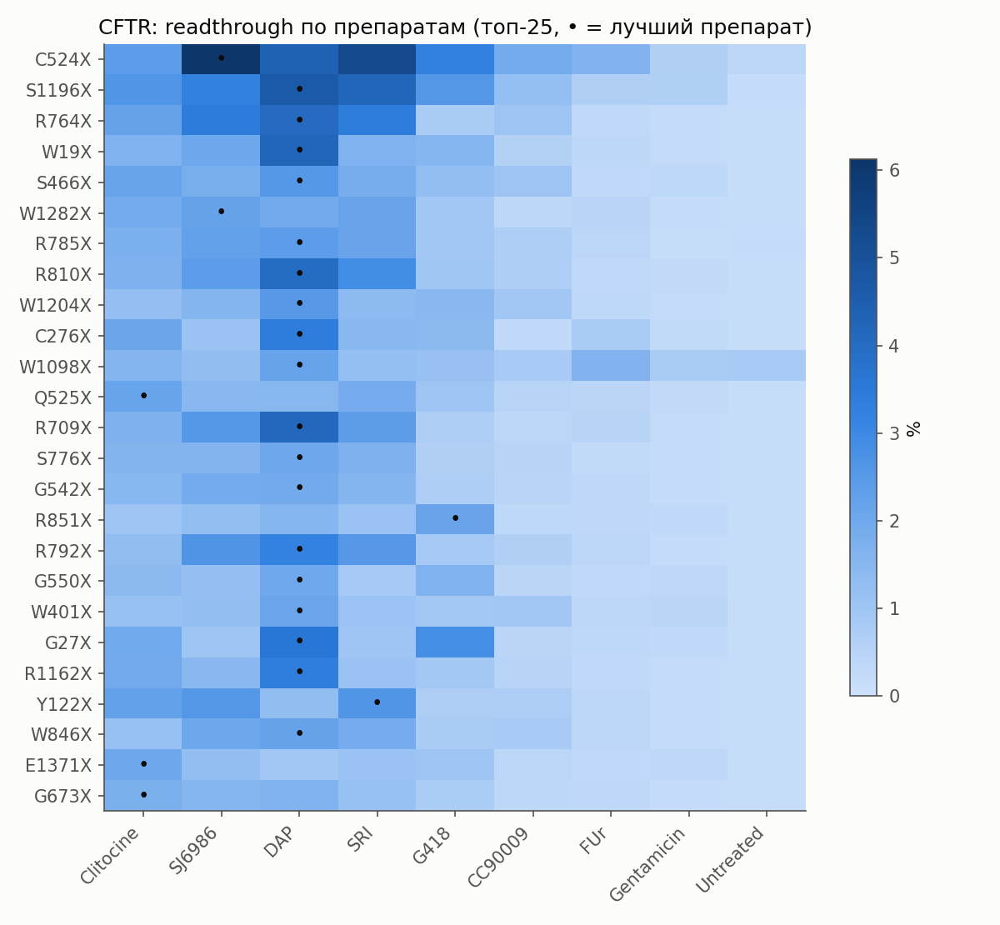

# Темы магистерской: ML + CFTR (генная терапия / readthrough), только открытые данные

Контекст: магистратура «Науки о данных», фокус — машинное обучение. Область — терапия муковисцидоза через CFTR (нонсенс-мутации / readthrough, модуляторы, генная терапия). Ограничение — всё на открытых данных, без собственной «мокрой» лаборатории.

---

## 1. Ключевые открытые источники данных

| Источник | Что даёт | Формат |
|---|---|---|
| [Toledano et al. 2024, Nature Genetics](https://www.nature.com/articles/s41588-024-01878-5) (полный текст открыт: [PMC11387191](https://pmc.ncbi.nlm.nih.gov/articles/PMC11387191/)) + [GitHub lehner-lab/Stop_codon_readthrough](https://github.com/lehner-lab/Stop_codon_readthrough) | Readthrough ~5 800 патогенных стоп-кодонов человека, измеренный **8 разными препаратами** (MPRA). Главный датасет для readthrough-темы | код + данные на GitHub/Zenodo |
| [Mangkalaphiban et al. 2024, Nat Commun](https://www.nature.com/articles/s41467-024-46703-z) (полный текст: [PMC10954755](https://pmc.ncbi.nlm.nih.gov/articles/PMC10954755/)) | ML-предсказание эффективности readthrough по расширенному контексту стоп-кодона (HEK293T), 13–15 CFTR PTC, G418 | открытые данные: [GitHub](https://github.com/Jacobson-Lab/AG_readthrough) + [Zenodo](https://zenodo.org/records/10698037) |
| [Lebeda et al. 2024, J Mol Med](https://link.springer.com/article/10.1007/s00109-024-02436-6) ([PubMed](https://pubmed.ncbi.nlm.nih.gov/38430393/)) | Двухрепортёрная high-content система: readthrough 14 MECP2 PTC (G418); данные — supplementary/по запросу | supplementary; продолжение с открытой панелью контекстов: [Smoljanow 2025, PLOS Genet](https://journals.plos.org/plosgenetics/article?id=10.1371/journal.pgen.1011753) |
| [CFTR2 (cftr2.org)](https://cftr2.org) | Клиническая + функциональная аннотация >1 000 CFTR-вариантов | веб-интерфейс (без bulk-выгрузки) |
| [ClinVar](https://www.ncbi.nlm.nih.gov/clinvar/) | Bulk-выгрузка CFTR-вариантов с патогенностью | VCF/TSV, полностью открыт |
| [Raraigh et al. 2024 (CF Genome Project)](https://www.cysticfibrosisjournal.com/article/S1569-1993(24)01129-3/fulltext) | Консолидированный каталог CFTR-вариантов из 9 источников (CFTR2, ClinVar, CFTR-France и др.) | открытая публикация + данные |
| [PubChem BioAssay](https://pubchem.ncbi.nlm.nih.gov/) | qHTS по CFTR: например [AID 743267](https://pubchem.ncbi.nlm.nih.gov/bioassay/743267) (Broad MLPCN, корректоры F508del-CFTR), плюс десятки других ассеев Verkman/Broad (потенциаторы, ингибиторы, YFP-галогенидные ассеи) | SDF/CSV, полностью открыт |
| [ChEMBL](https://www.ebi.ac.uk/chembl/) | Биоактивности соединений против CFTR (агрегированные ассеи) | SQL/CSV, открыт |
| [PDB](https://www.rcsb.org/) | Крио-ЭМ структуры CFTR (апо, с ивакафтором/лумакафтором и др.) + AlphaFold | открыт |
| [Sample et al. 2019 (optimus 5-UTR)](https://github.com/pjsample/human_5utr_modeling) | MPRA-датасет 280k последовательностей 5'UTR + CNN-модель экспрессии — готовая база для дизайна мРНК | открыт (GEO + GitHub) |
| [Bryant et al. 2021, Nat Biotech](https://www.nature.com/articles/s41587-010-00610-z) + GitHub | ML-дизайн капсидов AAV2 (обучающая выборка жизнеспособности капсидных вариантов) | открыт |
| ESM-2 / ProtT5 / AlphaFold | Белковые языковые модели — признаки для любого варианта CFTR | открытые веса |

---

## 2. Идеи тем

### Идея 1 (рекомендую). Предсказание лекарственно-индуцированного readthrough для нонсенс-вариантов CFTR

**Научный вопрос.** Нонсенс-мутации — ~10% случаев МВ (G542X, W1282X, R553X, …). Препараты-readthrough (ataluren, ELX-02, аминогликозиды) работают сильно по-разному для разных стоп-контекстов. Можно ли по последовательности мРНК и структуре белка предсказать, какие CFTR-нонсенс-варианты дадут клинически значимый ответ на конкретный препарат — и приоритизировать варианты/препараты?

**Постановка ML-задачи.** Многозадачная регрессия: вход — контекст стоп-кодона (±100–200 нт), предсказание вторичной структуры РНК, кодона вверх по потоку, консервация, домен CFTR, где случился стоп; выход — эффективность readthrough для каждого из N препаратов. Трансфер с геномного уровня (Toledano, 5 800 кодонов) на CFTR-специфичный анализ; внешняя валидация на независимых датасетах (Mangkalaphiban 2024, Lebeda 2024).

**Данные.** Toledano 2024 (open, с кодом) — обучение; ClinVar/CFTR2/Raraigh — панель всех известных CFTR-нонсенс-вариантов; UniProt/PDB — аннотация доменов.

**Новизна.** Toledano даёт модель «в среднем по геному»; Mangkalaphiban — ML по контексту, но без лекарств и без CFTR. Ниша: (а) drug-specific предсказание, (б) интеграция с NMD (стабильность мРНК — есть открытые предикторы), (в) полный in silico-каталог «CFTR-нонсенс-вариант × прогноз ответа × препарат» как артефакт работы.

**Методы/базлайны.** Логистическая/линейная регрессия по известным признакам (+4 нт и т.п.) → градиентный бустинг по инженерным признакам → CNN/Transformer по «сырой» последовательности → мультитаск. Оценка: Spearman/RMSE на held-out кодонах, валидация на внешних датасетах.

**Риски.** Модель Toledano уже существует — надо чётко ограничить вклад (CFTR-приложение, новые признаки, внешние данные). Низкий риск по данным: всё открыто и скачано.

**Оценка.** Данные: ★★★★★ · ML-глубина: ★★★★ · Новизна: ★★★★ · Биомедицинская значимость: ★★★★★

---

### Идея 2. Предсказание ответа CFTR-вариантов на корректоры/потенциаторы (ELX/TEZ/IVA)

**Научный вопрос.** Тройная терапия (Trikafta) одобрена для ~90–95% известных вариантов, но для сотен редких вариантов ответ неизвестен. Можно ли предсказать fold-change функции CFTR от модулятора по признакам варианта?

**Постановка ML-задачи.** Регрессия/ранжирование: вход — вариант (позиция в структуре, признаки ESM-2, домен, класс мутации, предсказанный эффект на фолдинг), выход — ответ на корректор/потенциатор из литературных данных (forskolin-induced swelling, Ussing chamber и т.п.).

**Данные.** Литературные таблицы ответов (Van Goor et al., обзоры + статьи 2023–2024 о responsive-вариантах) придётся собрать вручную/полуавтоматически в curated-датасет — это часть вклада; CFTR2 + Raraigh — аннотации; PDB/AlphaFold — структуры; ESM-2 — эмбеддинги.

**Новизна.** Область горячая (2024–2026), но публичной воспроизводимой модели нет — большинство статей без кода и данных. Сильный вклад: открытый воспроизводимый датасет + модель.

**Риски.** Разметка разнородная и маленькая (сотни точек, разные ассеи) — придётся аккуратно нормализовать и оставить внешнюю валидацию. Это главный риск темы.

**Оценка.** Данные: ★★★ (нужно кураторство) · ML: ★★★★ · Новизна: ★★★★ · Значимость: ★★★★★

---

### Идея 3. ML-скрининг новых малых молекул — модуляторов CFTR

**Научный вопрос.** Можно ли из открытых qHTS-данных переобучить модель и провести виртуальный скрининг на новые классы потенциаторов/корректоров?

**Постановка ML.** QSAR / GNN (DeepChem, PyG) на PubChem AID 743267 + Verkman-ассеях + ChEMBL; докинг в открытые структуры CFTR как дополнительные признаки; active learning для отбора кандидатов.

**Данные.** Полностью открыты и велики (десятки–сотни тысяч соединений) — самый «большие данные» вариант.

**Новизна.** QSAR по HTS — классика; новизна ниже, чем в идеях 1–2, но тема самая «датасайенсная» и без проблем с разметкой. Хорошо сочетается с идеей 2 (общие признаки).

**Риски.** Без лаборатории валидация только вычислительная (retrospective screening, enrichment). Новизну придётся добирать методикой (active learning, мультитаск по ассеям, докинг-фьюжн).

**Оценка.** Данные: ★★★★★ · ML: ★★★★ · Новизна: ★★★ · Значимость: ★★★★

---

### Идея 4. Генеративный дизайн мРНК-CFTR для генной терапии (UTR + кодон-оптимизация)

**Научный вопрос.** мРНК-терапия и векторная доставка CFTR ограничены экспрессией и стабильностью мРНК. Можно ли ML-методом спроектировать 5'UTR и кодон-оптимизацию CFTR, максимизирующую предсказанную экспрессию?

**Постановка ML.** Обучение CNN/Transformer на открытом MPRA-датасете 5'UTR (Sample et al. 2019, 280k последовательностей) → генеративный дизайн (VAE/градиентная оптимизация в латентном пространстве) 5'UTR под кодон-оптимизированный CFTR; совместно — модель стабильности мРНК по кодоновому составу (открытые датасеты stability-MPRA).

**Данные.** Открытые, готовые, с готовыми бейзлайн-моделями (optimus). CFTR-специфика — целевой ORF (1480 а.к., 4.4 т.п.н.) и ограничение размера для AAV.

**Новизна.** UTR-дизайн generic-инструменты есть; применение к CFTR + совместная оптимизация UTR×кодоны×размер — достаточно для магистерской, артефакт — панели in silico-кандидатных мРНК.

**Риски.** Без лаборатории — только вычислительная проверка (предсказанные метрики, консенсус моделей). Для магистерской по DS это обычно допустимо.

**Оценка.** Данные: ★★★★★ · ML: ★★★★★ (генеративные модели) · Новизна: ★★★ · Значимость: ★★★★

---

### Идея 5. In silico-планирование prime/base-редактирования CFTR-мутаций

**Научный вопрос.** Для каких патогенных CFTR-вариантов коррекция base/prime-редактированием технически осуществима с высокой предсказанной эффективностью, и как её максимизировать выбором pegRNA?

**Постановка ML.** Использовать открытые датасеты эффективности prime editing (например, данные DeepPE / тилинг-скрины PE — наличие конкретных выгрузок проверить на GitHub) → предсказание эффективности правок → применить к панели всех патогенных CFTR-вариантов (ClinVar/CFTR2) → интерактивный каталог стратегий.

**Данные.** PE-датасеты открыты частично; панель вариантов открыта. Нужна проверка конкретных выгрузок до фиксации темы.

**Новизна.** Хороший систематический вклад, ML-часть — в основном перенос и калибровка чужих моделей.

**Риски.** Готовые PE-предикторы уже существуют (DeepPE, PRIDICT) — вклад смещается в биоинформатику, а не ML. Брать, только если очень нравится генно-редакционная сторона.

**Оценка.** Данные: ★★★★ · ML: ★★★ · Новизна: ★★★ · Значимость: ★★★★

---

### Идея 6. NLP-конвейер: извлечение из литературы фактов «вариант CFTR × препарат × ответ»

**Научный вопрос.** Данные о ответах вариантов на модуляторы рассеяны по статьям. Можно ли автоматизировать их извлечение из открытого корпуса PMC и построить открытый структурированный датасет?

**Постановка ML.** NER (варианты, препараты, ассеи, численные ответы) + relation extraction на PubMedBERT/LLM с few-shot дообучением; оценочные метрики против вручную размеченного golden set; затем — обучение предиктора ответа (мост к идее 2).

**Данные.** PMC Open Access — полностью открыт; golden set размечаешь сам (~300–500 абстрактов).

**Новизна.** Самый «информационно-научный» вариант; артефакт (датасет) ценен сам по себе и закрывает главный риск идеи 2.

**Риски.** Это по сути другая дисциплина (IE/NLP), ML-биология уходит на второй план. Как самостоятельная тема — если нравится NLP; как модуль — отлично усиливает идею 2.

**Оценка.** Данные: ★★★★★ · ML: ★★★★ (NLP) · Новизна: ★★★★ · Значимость: ★★★★

---

## 3. Рекомендация

**Основной выбор — Идея 1 (readthrough):** максимальное совпадение с интересом (нонсенс-мутации CFTR + readthrough), лучший открытый датасет под задачу (Toledano 2024, с кодом), чистая ML-постановка и понятная ниша новизны (drug-specific + CFTR-каталог + интеграция с NMD).

**Запасной вариант — Идея 4 (дизайн мРНК):** если хочется генеративных моделей и ближе «генная терапия», а не readthrough.

**Усиление:** идеи 1+2 (или 2+6) можно объединить в одну работу «предсказание терапевтического ответа CFTR-вариантов: readthrough + модуляторы» — два приложения одной ML-методологии.

## 4. Следующие шаги (перед фиксацией темы)

1. Скачать репозиторий Toledano, оценить: сколько CFTR-нонсенс-вариантов в их данных, какие препараты, качество разметки.
2. Собрать панель CFTR-нонсенс-вариантов из ClinVar + Raraigh 2024, пересечь с Toledano — понять размер тестовой выборки.
3. Прочитать Mangkalaphiban 2024 — зафиксировать, чем именно отличаемся.
4. Согласовать формулировку с научруком: достаточно ли «in silico-валидация» без лаборатории (обычно да для DS-магистерской).

---

## 5. Количественные характеристики датасетов (проверено по API 2026-09-23)

### Readthrough — Toledano et al. 2024

| Параметр | Значение |
|---|---|
| Библиотека PTC | **5 871 вариант** (3 498 менделевских из ClinVar + 2 372 соматических из TCGA/MSK-IMPACT + контроли) |
| Условия | 8 препаратов + без лечения = 9 → **~52 800 измерений** «вариант × препарат» |
| Контекст в конструкте | ±72 нт вокруг стоп-кодона |
| Препараты | clitocine, DAP, SRI, SJ6986, CC90009, G418, гентамицин, FUr (ataluren и ELX-02 **отсутствуют**) |
| Внешняя валидация | ~18 800 природных стоп-кодонов (NTC-библиотека) |
| Согласование с индивидуальными измерениями | r = 0.95 |
| RTDetective (figshare, CC BY 4.0) | 24 txt-файла, **~10.9 GB** — предсказания для всех возможных нонсенс-сайтов генома × 8 препаратов × 3 типа стопа |
| Модель | elastic net (R), 4 группы признаков; CV r² 0.55–0.89 (зависит от препарата) |
| Код | R Markdown, полный прогон ~2 дня; SRA PRJNA996618 и PRJNA1073909 |

### CFTR-варианты

| Параметр | Значение |
|---|---|
| ClinVar: всего записей CFTR | **6 466** |
| ClinVar: нонсенс-варианты CFTR | **853** — целевое пространство для readthrough-темы |
| CFTR2 | >1 000 аннотированных вариантов (веб-интерфейс) |
| Raraigh et al. 2024 | консолидированный каталог из 9 источников |
| ⚠️ Открытый вопрос | сколько из 853 нонсенс-вариантов CFTR входит в библиотеку Toledano (5 871) — **проверить пересечение первым делом** |

### Малые молекулы — модуляторы CFTR

| Параметр | Значение |
|---|---|
| PubChem BioAssay, ассеи по запросу «CFTR» | **1 460** |
| AID 743267 (Broad MLPCN, корректоры F508del, YFP-ассей в CFBE, дозозависимый confirmatory) | протестировано **1 170 веществ**, активных **605**, с AC50 в мкМ-диапазоне — 47 |
| Первичный скрин этого проекта | отдельные AID (сотни тысяч соединений MLPCN) — сопутствующие записи того же проекта |
| ChEMBL | API недоступен из текущей сессии; считать вручную на сайте (агрегированные CFTR-активности) |

### Дизайн мРНК — Sample et al. 2019 (5'UTR MPRA)

| Параметр | Значение |
|---|---|
| Библиотека | **≈280 тыс. последовательностей** (сотни тысяч рандомизированных 5'UTR + 35 000 усечённых человеческих + 3 577 натуральных вариантов) |
| Данные | GEO GSE114002 + готовая CNN-модель «optimus 5-UTR» на GitHub (Keras/TF) |

### AAV-капсиды — Bryant et al. 2021

| Параметр | Значение |
|---|---|
| Библиотека | **201 426 вариантов** 28-а.к. сегмента VP1 AAV2, из них **110 689 жизнеспособных** (бинарная метка) |
| Данные | GitHub + подготовленная версия на HuggingFace (`bviggiano/aav2_capsid_viability`) |

---

## 6. Предварительный анализ данных Toledano (EDA, 2026-09-30)

Код: `toledano_data/eda.ipynb` (ноутбук с выводами; раньше — `eda.py`) · данные: `toledano_data/treated_samples.rds` (figshare «Main dataset») · экспорт: `toledano_data/cftr_readthrough.csv` · графики: `toledano_data/figs/`

### Датасет после очистки

- 105 066 строк → усреднение репликат → **5 484 варианта × 9 условий** (8 препаратов + контроль), 2 биологические реплики.
- Дырки в RT минимальны: 24–89 NaN на препарат (<1%).
- RT в % от WT-экспрессии; медианы: Untreated 0.17 → Gentamicin 0.21 → FUr 0.34 → CC90009 0.38 → G418 0.57 → DAP 1.15 → SRI 1.13 → SJ6986 1.32 → Clitocine 1.49.

**Порог «любой препарат» vs один препарат** (доля вариантов, %):

| Порог RT | любой препарат | только DAP | только Gentamicin |
|---|---|---|---|
| > 0.5% | 99.4 | 84.7 | 3.4 |
| > 1% | 85.4 | 54.5 | 0.7 |
| > 2% | **50.8** | 38.9 | 0.0 |

50.8% воспроизводит заявленные в статье 50.3% — датасет и пайплайн согласованы.

### Детерминанты readthrough

- Тип стоп-кодона (UGA > UAG ≥ UAA почти для всех препаратов) и нуклеотид +4 (C почти всегда лучший) видны прямо из данных — признаки статьи работают.

- Препараты коррелируют умеренно (Spearman ~0.4–0.8) — выбор препарата действительно индивидуален, «одна таблетка для всех» не работает.

### CFTR: прямые измерения уже есть для 76 вариантов

Из 853 нонсенс-вариантов CFTR в ClinVar **76 измерены напрямую** (~9%) — это готовый тестовый набор внутри датасета.

Ключевые клинические варианты (% readthrough, лучший препарат):

| Вариант | Лучший RT | Примечание |
|---|---|---|
| S1196X | **4.7% (DAP)** | |
| R553X | 2.6% (DAP) | частая мутация у славян |
| W1282X | 2.2% (SJ6986) | частая у ашкенази |
| G542X | **1.9% (DAP)** — ниже порога 2% | самая частая нонсенс-мутация CF |

- **33 из 76** CFTR-вариантов превышают RT 2% хотя бы одним препаратом.
- Лучший препарат для CFTR-вариантов чаще всего **DAP** (33 варианта), затем Clitocine (21), SJ6986 (12).

### Выводы для темы

1. Датасет полностью воспроизводится локально, качество разметки высокое, OOM-ловушка только в категориальных колонках RDS (фиксится `astype(str)`).
2. Ниши подтверждаются: ataluren/ELX-02 в данных нет; модель статьи — линейная; 777 CFTR-нонсенс-вариантов ClinVar не измерены — кандидаты на предсказание.
3. Ядро магистерской может быть: drug-aware модель (не «вариант → RT вообще», а «вариант × препарат → RT» с переносом на неизмеренные CFTR-варианты) + внешняя валидация на Mangkalaphiban/Lebeda.
4. Базлайн для победы: бейзлайн статьи (elastic net по ±3 нт) нужно воспроизвести на разбиении по генам (чтобы проверить перенос на CFTR, которых нет в train).

---

## 7. Deep research: новизна и точная формулировка задачи (27.09.2026)

4 параллельных ресёрч-потока: (1) ML-SOTA readthrough, (2) клинический ландшафт нонсенс-CF, (3) NMD × readthrough, (4) CFTR-вариантные данные. Итоги ниже.

### 7.1 Что уже занято (карта конкурентов)

| Работа | Что сделано | Чего НЕ сделано |
|---|---|---|
| Toledano et al. 2024, Nat Genet ([статья](https://www.nature.com/articles/s41588-024-01878-5), [PMC](https://pmc.ncbi.nlm.nih.gov/articles/PMC11387191/), [код](https://github.com/lehner-lab/Stop_codon_readthrough)) | 5 871 PTC × 8 препаратов; elastic net (±3 нт); предсказания на весь геном | линейная модель, нет NMD/белковых признаков, одна клеточная система |
| **TransStop** ([bioRxiv 08.2025](https://www.biorxiv.org/content/10.1101/2025.08.29.672857v1.full-text), Страсбург) | fine-tune Nucleotide Transformer на данных Toledano, **drug embeddings**, pan-drug R²=0.94 | **CFTR только in-silico**, нет held-out переноса на неизмеренные варианты, нет NMD, нет PLM, один репортер в HEK293T; не рецензирована; [код](https://github.com/Dichopsis/TransStop) открыт |
| Mangkalaphiban et al. 2024, Nat Commun ([статья](https://www.nature.com/articles/s41467-024-46703-z), [PMC](https://pmc.ncbi.nlm.nih.gov/articles/PMC10954755/), [код](https://github.com/Jacobson-Lab/AG_readthrough), [данные](https://zenodo.org/records/10698037)) | RF на 75 признаках; измерено 13–15 CFTR PTC (G418); proof-of-concept «контекст предсказывает CFTR-readthrough» | один препарат, мало данных, не доведено до decision-tool |
| NMDetective-AI ([bioRxiv](https://www.biorxiv.org/content/10.64898/2026.03.24.714003v1), [код](https://github.com/Vejni/NMDetectiveAI)) / predNMD ([bioRxiv](https://www.biorxiv.org/content/10.64898/2026.06.20.733449v1), [сайт](https://compbio.berkeley.edu/proj/prednmd/)) | количественные NMD-предикторы для всех PTC, открытые скоры | только NMD-половина; с readthrough никто не объединял |
| HIT-CF / Destoop et al. 2026, JCF ([doi](https://doi.org/10.1016/j.jcf.2026.09.004), [bioRxiv](https://www.biorxiv.org/content/10.64898/2026.07.31.740556), [hitcf.org](https://www.hitcf.org/)) | 206 пациент-производных органоидов × ELX-02: ответ варьирует на порядки | лабораторный (не in silico) метод отбора: биопсия, недели, дорого |

Клинический контекст: ataluren провалил два Ph3 ([Konstan 2014](https://pmc.ncbi.nlm.nih.gov/articles/PMC4154311/), [ACT CF 2020](https://pubmed.ncbi.nlm.nih.gov/31983658/)), ELX-02 — Ph2 (обе программы набирали «всех подряд» нонсенс-пациентов без стратификации по контексту); **активных readthrough-испытаний при CF сейчас нет**, следующая волна (супрессорные тРНК, R-ASO, усилители аминогликозидов — [обзор JCF 2026](https://doi.org/10.1016/j.jcf.2026.02.014)) — вся преклиническая. ~10% пациентов CF (~5–7 тыс. в Европе, ~400–450 в РФ) не охвачены модуляторами принципиально — у них нет белка-мишени. In silico-компаньон-диагностика для readthrough свободна.

### 7.2 Открытые ниши (пересечение всех отчётов)

1. **Перенос на неизмеренные варианты** с честной валидацией (leave-one-gene-out, CFTR целиком в тест) + внешние CFTR-датасеты: Mangkalaphiban (13 PTC, G418), Thrasher 2025/2026 (6 PTC, LC-MS/MS), Destoop 2026 (206 органоидов, ELX-02). TransStop показал R² только на случайном сплите.
2. **Leave-one-drug-out**: zero-shot предсказание для препарата, которого нет в обучении (аналог ataluren — его в данных Toledano нет).
3. **Интеграция NMD**: RT × NMD-escape → ожидаемый выход полноформатного белка. Обе половины открыты (Toledano + NMDetective/predNMD), соединения не существует. ⚠️ Риск: группа Supek/Lehner владеет обеими половинами — окно сужается.
4. **Предсказание вставляемой аминокислоты** (near-cognate tRNA) и её функциональных последствий — вычислительной модели нет вовсе, экспериментальные данные по CFTR есть: [Thrasher 2025/2026, JCF](https://doi.org/10.1016/j.jcf.2025.09.006) ([диссертация](https://digitalcommons.library.uab.edu/cgi/viewcontent.cgi?article=8233&context=etd-collection)), [Premchandar 2024](https://www.frontiersin.org/journals/pharmacology/articles/10.3389/fphar.2024.1389586/full), [Xue 2017](https://pmc.ncbi.nlm.nih.gov/articles/PMC5886253/).
5. Бонус-ось (миссенс): вариант-уровневой публичной модели ответа на корректоры тоже нет; данные Schlebachа открыты: [McKee 2023](https://pmc.ncbi.nlm.nih.gov/articles/PMC10330547/) (129 вариантов, VX-661/VX-445), [Tedman 2025](https://elifesciences.org/articles/107180) (232 варианта, ±CANX); [McDonald 2024](https://journals.plos.org/plosone/article?id=10.1371/journal.pone.0297560) — AlphaMissense не предсказывает фармакологический ответ.

### 7.3 Точная формулировка задачи исследования

**Рабочее название.** «In silico-стратификация нонсенс-вариантов CFTR для readthrough-терапии: drug-aware предсказание эффективности и функционального исхода по последовательности».

**Формальная постановка.**

- Вход: нуклеотидный контекст PTC (±10…72 нт из Toledano / полный транскрипт из ClinVar), идентификатор препарата (или класса), скоры NMD (NMDetective/predNMD), белковые признаки (домен, позиция, PLM-скор вставки).
- Выход 1 (ядро): `RT(variant, drug)` — регрессия, % от WT.
- Выход 2: `E[полноформатный белок] ≈ RT × NMD-escape` — предсказание эндогенного ответа.
- Выход 3 (артефакт): открытый каталог «853 ClinVar CFTR-нонсенс-варианта × препарат» с интервалами неопределённости — готовый инструмент отбора когорт для будущих испытаний.

**Протокол оценки.**
- Внутренний: 10× CV (сравнение со статьёй) + **leave-one-gene-out** (главное разбиение; CFTR и топ-гены целиком в тесте).
- Перенос на препараты: **leave-one-drug-out** (8 прогонов).
- Внешняя валидация (CFTR, три независимых системы): Mangkalaphiban — 13 PTC, dual-luciferase, G418; Thrasher — 6 PTC, LC-MS/MS + функция; Destoop — органоиды, ELX-02 (если данные доступны из bioRxiv-сапплемента).
- Метрики: Spearman ρ, RMSE по log(RT), точность выбора лучшего препарата (top-1/top-2), калибровка на пороге RT>2%.

**Бейзлайны.** (1) правила (+4 nt, тип стопа); (2) elastic net Toledano (reimpl.); (3) градиентный бустинг на инженерных признаках + NMD; (4) TransStop (воспроизведение по открытому коду; не рецензирован — их числа тоже надо проверить).

### 7.4 Финальные гипотезы

| # | Гипотеза | Проверка | Статус после ресёрча |
|---|---|---|---|
| H1 | Модель на расширенном контексте (нейросеть/бустинг + вторичная структура РНК) превосходит elastic net на **leave-one-gene-out**, особенно на слабых препаратах (CC90009, гентамицин, FUr) | LOD-CV, сравнение с reimpl. бейзлайном | уточнена: TransStop показал превосходство только на случайном сплите; перенос на unseen-гены — открытый вопрос |
| H2 | Drug-эмбеддинги дают осмысленный **zero-shot перенос на неизмеренный препарат** (leave-one-drug-out; аналог ataluren) | 8 прогонов LOD | новая формулировка: TransStop drug embeddings имеет, но LOD не проверял |
| H3 | Модель, обученная на геномной библиотеке, ранжирует измеренные CFTR-варианты (76 Toledano + 13 Mangkalaphiban + 6 Thrasher) не хуже модели только на CFTR — геномные данные переносимы | held-out + внешние датасеты | подтверждаема: данных достаточно |
| H4 | NMD-признаки улучшают предсказание **эндогенного** ответа (органоиды Destoop), но не репортерного RT | ablation: ± NMD-скоры | сильная: интеграции нет ни у кого; риск — Supek/Lehner |
| H5 | Идентичность вставляемой аминокислоты предсказуема из контекста; PLM-оценка функциональных последствий вставки коррелирует с функцией CFTR | данные Thrasher/Xue/Premchandar как тест | самая свежая ниша: модели не существует вовсе; данных мало → как второй фронт |
| H6 | (опционально, риск) Модель допускает экстраполяцию на комбинации TRID+NMDi | данных комбинаций мало | не обязательна для защиты |

### 7.5 Риски и решения

1. **Supek/Lehner объединят свои половины** (readthrough-модель + NMDetective-AI) раньше нас → решение: фокус на CFTR-валидацию и клинический артефакт, которого у них не будет; писать быстро.
2. **TransStop не рецензирован**, их R²=0.94 невоспроизводимы из коробки → решение: воспроизвести по коду как бейзлайн; если не воспроизведётся — это тоже результат.
3. **Органоидные данные Destoop** могут оказаться «по запросу» → решение: fallback на Mangkalaphiban + Thrasher как внешняя валидация.
4. Ataluren нет в обучающих данных → это не баг, а дизайн-фича: чистый тест H2.

### 7.6 План работ (каркас)

1. **Этап 1:** пайплайн данных (Toledano + join ClinVar/CFTR2 + NMD-скоры), reimpl. бейзлайнов, LOD-CV фреймворк.
2. **Этап 2:** drug-aware модель (мультитаск / трансформер малый), H1–H3, воспроизведение TransStop.
3. **Этап 3:** NMD-интеграция и внешняя CFTR-валидация (H4).
4. **Этап 4:** вставка аминокислот (H5) и/или каталог-артефакт + текст.

### 7.7 Новизна в рамках постановки (формулировки для автореферата)

1. **Валидационная новизна (самая прочная).** Ни Toledano (elastic net), ни TransStop (R²=0.94) не проверяли переносимость: оба оценивают на случайном сплите, где варианты одного гена есть и в train, и в test. Впервые проводится систематическая оценка обобщающей способности readthrough-моделей по протоколам **leave-one-gene-out** и **leave-one-drug-out**. Даже при равенстве R² результат «насколько падает качество на невидимых генах/препаратах и какие признаки этому помогают» — новое эмпирическое знание.

2. **Методическая новизна.** **Первая интеграция NMD-признаков** в предсказание readthrough-ответа: составная модель ожидаемого эндогенного выхода белка `RT × NMD-escape` (компоненты открыты — Toledano + NMDetective/predNMD, композиция не публиковалась). Формулировка: «впервые предложена составная модель терапевтического выхода белка, объединяющая эффективность readthrough и NMD-статус транскрипта».

3. **Прикладская новизна.** **Первый открытый CFTR-каталог** «нонсенс-вариант × препарат» с неопределённостью для всех 853 ClinVar-вариантов + **кросс-системная валидация** на трёх независимых датасетах (репортер Mangkalaphiban, LC-MS/MS Thrasher, органоиды Destoop). Позиционирование: in silico компаньон-диагностика для отбора когорт в readthrough-испытания — на сентябрь 2026 свободна, при том что провал ataluren/ELX-02 объясняется именно отсутствием стратификации.

4. **Exploratory-новизна (второй фронт, риск).** Предсказание **вставляемой аминокислоты** из контекста: вычислительной модели не существует вовсе (Roy & Jacobson 2015 констатировали потребность — с 2015 не построена). Данных мало (Thrasher/Xue/Premchandar), поэтому не ядро работы.

**Чего в новизне нет (не заявлять на защите):** drug-aware глубокое обучение на данных Toledano (занято TransStop — воспроизводим как бейзлайн); сам датасет и биология контекста (+4 nt, UGA>UAG — из статьи 2024); NMD-предикторы (чужие; наш вклад — join и проверка полезности).

**Одной фразой:** новизна — не «ещё одна модель повыше R²», а (а) первая честная оценка обобщающей способности readthrough-моделей, (б) первая композитная модель выхода белка RT×NMD, (в) первый валидированный CFTR-каталог для стратификации пациентов при доказанном клиническом разрыве.
